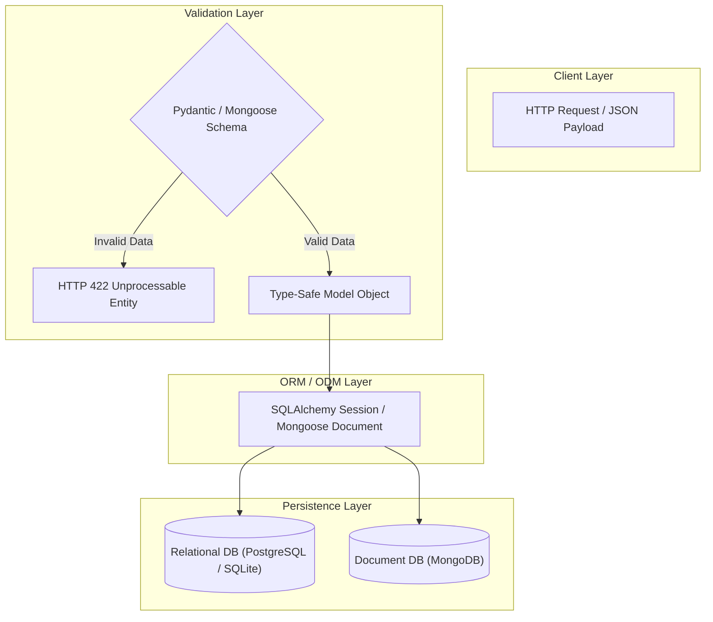

# Backend Development Hub 🚀

[](https://nodejs.org/)
[](https://expressjs.com/)
[](https://python.org/)
[](https://fastapi.tiangolo.com/)
[](https://flask.palletsprojects.com/)
[](https://www.sqlalchemy.org/)
[](https://www.mongodb.com/)
[](https://www.postgresql.org/)

A comprehensive, production-grade backend engineering curriculum and laboratory portfolio. This repository bridges modern web protocols, API architectures, server-side rendering, client/server state persistence, and full database modeling across both **Node.js / Express** and **Python (FastAPI, Flask, SQLAlchemy)** ecosystems.

---

## Table of Contents

- [Repository Architecture](#repository-architecture)
- [Assignments](#assignments)
- [Technology Matrix](#technology-matrix)
- [Curriculum Breakdown](#curriculum-breakdown)
  - [1. Laboratory Experiments (`Lab/`)](#1-laboratory-experiments-lab)
  - [2. Theory Practical Curriculum (`Theory/`)](#2-theory-practical-curriculum-theory)
  - [3. Database & Container Environments](#3-database--container-environments)
- [Quick-Start Execution Cheat Sheet](#quick-start-execution-cheat-sheet)
- [Data Modeling & Validation Highlights](#data-modeling--validation-highlights)
- [Reference & Acknowledgements](#reference--acknowledgements)

---

## Repository Architecture

```text
Backend Development/
├── Readme.md                             # Central Repository Guide & Showcase
├── package.json                          # Root Node.js dependencies
│
├── Assignment/                           # Graded Assignments
│   ├── README.md                         # Assignment index & run instructions
│   ├── Assignment-1/                     # Simple Notes App (HTML/CSS/JS + localStorage)
│   │   ├── index.html
│   │   ├── style.css
│   │   ├── script.js
│   │   └── README.md
│   └── Assignment-2/                     # PostgreSQL JSONB vs MongoDB
│       ├── README.md                     # Conceptual answers & task walkthrough
│       ├── products.sql                  # PostgreSQL schema, queries & GIN index
│       └── products.mongodb.js           # Equivalent MongoDB operations
│
├── Lab/                                  # Laboratory Experiments & Full-Stack Projects
│   ├── Readme.md                         # Laboratory Curriculum Hub
│   ├── Experiment-1/                     # Exp 1: Semantic HTML5 & Web Forms
│   │   ├── Experiment-1.html
│   │   └── README.md
│   ├── Experiment-7-8/                   # Exp 7-8: ES6 Client-Side Task Manager
│   ├── Experiment-12A/                   # Exp 12A: Express REST API & EJS SSR
│   │   ├── Readme.md
│   │   └── nodejs-express-lab/
│   ├── Experiment-12B/                   # Exp 12B: Cookies & Sessions
│   ├── Experiment-15/                    # Exp 15: Django To-Do Application
│   ├── Lab-Assessment-B/                 # Assessment: Eisenhower Matrix Todo App
│   └── Student-API/                      # FastAPI + SQLAlchemy Student Management API
│
├── Theory/                               # Academic Theory Tasks & Practical Implementations
│   ├── Readme.md                         # Theory Curriculum Hub
│   ├── Unit-1/                           # Unit 1: Foundations of Backend Development
│   ├── Task-2/                           # Task 2: Flask Student Management REST API
│   ├── Task-3/                           # Task 3: FastAPI REST API with Uvicorn
│   ├── Task-4/                           # Task 4: Nodemon Developer Workflow
│   ├── Task-5/                           # Task 5: Server-Side Rendering (FastAPI + Jinja2)
│   ├── Task-6/                           # Task 6: Client-Side State & Web Storage
│   ├── Lecture-15/                       # Lecture 15: Data Modeling (ORM & ODM)
│   ├── Lecture-16/                       # Lecture 16: Database CRUD Operations
│   ├── Unit-4/                           # Unit 4: Docker & Multi-Database Environments
│   ├── Express-Demo/                     # Express Server Bootstrapping & Routing
│   └── Express-in-Docker/                # Dockerized Express Microservice
│
├── index.html                            # EndpointCraft portfolio website
├── css/                                  # Website styles
├── js/                                   # Website application & embedded content manifest
├── content.json                          # Generated portfolio content manifest
├── build_manifest.py                     # Regenerates content.json / js/content.js
└── .github/workflows/                    # GitHub Pages deployment workflow
```

---

## Assignments

| # | Assignment | Folder | Stack |
|---|---|---|---|
| 1 | Simple Notes App | [`Assignment/Assignment-1/`](./Assignment/Assignment-1/) | HTML5, CSS3, Vanilla JavaScript, `localStorage` |
| 2 | PostgreSQL as SQL + NoSQL (JSONB) | [`Assignment/Assignment-2/`](./Assignment/Assignment-2/) | PostgreSQL, JSONB, MongoDB |

* **[Assignment 1: Simple Notes App](./Assignment/Assignment-1/README.md)**: Add, display, delete, and persist notes in the browser with `localStorage`.
* **[Assignment 2: PostgreSQL JSONB vs MongoDB](./Assignment/Assignment-2/README.md)**: `json` vs `jsonb`, hybrid relational/document modelling, JSONB operators, GIN indexes, and equivalent MongoDB queries.

---

## Technology Matrix

| Technology | Category | Role in Repository | Notable Characteristics |
| :--- | :--- | :--- | :--- |
| **Node.js** | Runtime | Primary JavaScript execution environment | Asynchronous, non-blocking I/O event loop |
| **Express.js** | Framework | REST APIs & SSR routing | Minimalist, unopinionated, extensive middleware |
| **Python** | Runtime | Data modeling & modern backend services | Strict typing, readability, extensive ecosystem |
| **FastAPI** | Framework | High-performance ASGI REST APIs | Auto OpenAPI/Swagger UI, Pydantic validation |
| **Flask** | Framework | Microframework REST APIs | Lightweight WSGI server, simple routing patterns |
| **SQLAlchemy** | ORM | Relational database mapping | `back_populates` relationships, cascade deletes |
| **Mongoose** | ODM | Document database modeling | Schema validation, regex matching, embedded models |
| **MongoDB** | Database | NoSQL document storage | Flexible JSON-like BSON documents, dynamic schemas |
| **PostgreSQL** | Database | Relational SQL database | ACID compliance, strict foreign keys, check constraints |
| **EJS / Jinja2** | Templating | Server-Side Rendering (SSR) | HTML generation with dynamic server variable injection |

---

## Curriculum Breakdown

### 1. Laboratory Experiments ([`Lab/`](./Lab/Readme.md))

* **[Experiment 1: Semantic HTML5 Elements & Web Forms](./Lab/Experiment-1/README.md)**: Semantic page structure (`<header>`, `<nav>`, `<section>`, `<footer>`), input validation types, native `<canvas>` 2D graphics, and HTML5 `<audio>`/`<video>` controls.
* **[Experiment 7-8: ES6 Task Manager](./Lab/Experiment-7-8/Readme.md)**: ES6 classes, arrow functions, spread syntax, immutable state updates, and event delegation in a client-side To-Do application.
* **[Experiment 12A: Express REST API & EJS SSR](./Lab/Experiment-12A/Readme.md)**: Route parameters (`:id`), query parsing (`req.query` calculator), POST body handling, and dynamic template rendering.
* **[Experiment 12B: State Management](./Lab/Experiment-12B/Readme.md)**: Stateless HTTP mitigation using `cookie-parser` for client cookies and `express-session` for signed server-side session counters.
* **[Experiment 15: Django To-Do Application](./Lab/Experiment-15/README.md)**: Django MVT architecture, SQLite ORM models, migrations, template inheritance, and external API integration.
* **[Lab Assessment B: Eisenhower Matrix Application](./Lab/Lab-Assessment-B/Readme.md)**: Production-style CRUD application integrating Express.js, EJS, and native MongoDB driver to manage priority-classified tasks.
* **[Student API: FastAPI + SQLAlchemy](./Lab/Student-API/README.md)**: Production-style REST API with Pydantic validation, pagination, filtering, and cascade-safe CRUD operations.

---

### 2. Theory Practical Curriculum ([`Theory/`](./Theory/Readme.md))

* **[Unit 1: Foundations](./Theory/Unit-1/Readme.md)**: Network protocols, HTTP request/response cycle, status codes, and REST architectural constraints.
* **[Task 2: Flask REST API](./Theory/Task-2/Readme.md)**: Python microframework routing, JSON responses with `jsonify()`, and custom 404 error handlers.
* **[Task 3: FastAPI REST API](./Theory/Task-3/Readme.md)**: High-concurrency ASGI service with Uvicorn and interactive Swagger UI at `/docs`.
* **[Task 4: Nodemon DX](./Theory/Task-4/Readme.md)**: File-watcher-based auto-reloading developer workflow.
* **[Task 5: Server-Side Rendering](./Theory/Task-5/Readme.md)**: Dynamic server-rendered HTML views using FastAPI and Jinja2 templates.
* **[Task 6 / Lecture 7: Web Storage API](./Theory/Task-6/lecture7/Readme.md)**: Browser storage comparison between persistent `localStorage` and session-scoped `sessionStorage`.
* **[Lecture 15: Data Modeling (ORM & ODM)](./Theory/Lecture-15/ORM/Readme.md)**:
  - **Conceptual, Logical, and Physical Models**: ER diagrams, data types, constraints, and PostgreSQL physical DDL.
  - **SQLAlchemy ORM**: Student Management System with bidirectional `back_populates` and cascade deletion verification.
  - **PBL Activity (E-Commerce System)**: Full shopping cart, checkout, and inventory workflow in SQLAlchemy and Mongoose.
  - **Validation Pipelines**: Pydantic request validation (HTTP 201 & 422 error interception) and Mongoose schema constraints.
* **[Lecture 16: Database CRUD Operations](./Theory/Lecture-16/Readme.md)**: ACID transaction management, connection pooling, and SQL vs NoSQL query patterns.
* **[Express Demo](./Theory/Express-Demo/Readme.md)**: Express.js server bootstrapping, route registration, and HTTP request handling.

---

### 3. Database & Container Environments

* **[Unit 4: Docker & Multi-Database Environments](./Theory/Unit-4/README.md)**: Docker Compose stack provisioning PostgreSQL, MongoDB, pgAdmin, and Mongo Express with persistent volumes and internal networking.
* **[Express in Docker](./Theory/Express-in-Docker/README.md)**: Containerized Express microservice demonstrating host binding (`0.0.0.0`), port mapping, and container-friendly process management.
* **[Assignment 2: PostgreSQL JSONB](./Assignment/Assignment-2/README.md)**: Practical PostgreSQL schema, JSONB queries, GIN indexing, and MongoDB comparison.

---

## Quick-Start Execution Cheat Sheet

| Module | Location | Execution Command | Port / Access |
| :--- | :--- | :--- | :--- |
| **Assignment 1 (Notes)** | `Assignment/Assignment-1` | `Start-Process index.html` | Browser |
| **Assignment 2 (SQL)** | `Assignment/Assignment-2` | `psql -f products.sql` | PostgreSQL |
| **Assignment 2 (MongoDB)** | `Assignment/Assignment-2` | `mongosh products.mongodb.js` | MongoDB |
| **HTML5 Elements** | `Lab/Experiment-1` | `Start-Process Experiment-1.html` | Browser |
| **ES6 Task Manager** | `Lab/Experiment-7-8` | `Start-Process index.html` | Browser |
| **Express Lab 12A** | `Lab/Experiment-12A/nodejs-express-lab` | `npm install && node app.js` | `http://localhost:3000` |
| **Cookies Demo** | `Lab/Experiment-12B` | `node Cookies_example.js` | `http://localhost:3000/set-cookie` |
| **Sessions Demo** | `Lab/Experiment-12B` | `node session_example.js` | `http://localhost:3000` |
| **Django To-Do** | `Lab/Experiment-15` | `python manage.py migrate && python manage.py runserver` | `http://127.0.0.1:8000` |
| **Eisenhower Todo** | `Lab/Lab-Assessment-B` | `npm install && node app.js` | `http://localhost:3000` |
| **Student API** | `Lab/Student-API` | `pip install -r requirements.txt && python main.py` | `http://127.0.0.1:8000/docs` |
| **Flask API (Task 2)** | `Theory/Task-2` | `python app.py` | `http://127.0.0.1:5000/students` |
| **FastAPI (Task 3)** | `Theory/Task-3` | `python main.py` | `http://127.0.0.1:8000/docs` |
| **FastAPI SSR (Task 5)** | `Theory/Task-5` | `python main.py` | `http://127.0.0.1:8000/` |
| **Web Storage To-Do** | `Theory/Task-6/lecture7` | `Start-Process index.html` | Browser |
| **SQLAlchemy ORM (L15)**| `Theory/Lecture-15/ORM` | `python Database.py` | CLI Output |
| **E-Commerce PBL (L15)** | `Theory/Lecture-15/ORM` | `python ecommerce_models.py` | CLI Output |
| **FastAPI Validation** | `Theory/Lecture-15/ORM` | `python test_fastapi_validation.py` | CLI Output (201 & 422) |
| **Mongoose ODM (L15)** | `Theory/Lecture-15/ORM` | `node mongoose_models.js` | CLI Output |
| **Lecture 15 All-in-One**| `Theory/Lecture-15/ORM` | `python run_all.py` | CLI Output |
| **Docker Multi-DB** | `Theory/Unit-4/docker/docker-compose` | `docker compose up -d` | pgAdmin `:8094`, Mongo Express `:8081` |
| **Express in Docker** | `Theory/Express-in-Docker` | `npm install && npm start` | `http://localhost:3000` |

---

## Data Modeling & Validation Highlights



* **Zero corrupted state:** Strict validation occurs before route handlers or persistence layers touch the database.
* **Cascade safety:** Child rows (e.g. enrollments, order items) are automatically cleaned up when parent records are deleted, preventing orphaned data.
* **Database Agnostic:** Switching between development (SQLite) and production (PostgreSQL) requires updating only the connection URI without rewriting domain logic.

---

## Reference & Acknowledgements

This repository's folder organization, assignment briefs, and documentation conventions were prepared with reference to the Backend Development course portfolio maintained by **Aryan Malik**:

- [KinglyyyY/BackendDevelopment](https://github.com/KinglyyyY/BackendDevelopment)

The reference was used for structure and assignment guidance only. All coursework, code, and notes in this repository are maintained by **Kanishka Bhatt** (SAP ID: 590017366).
